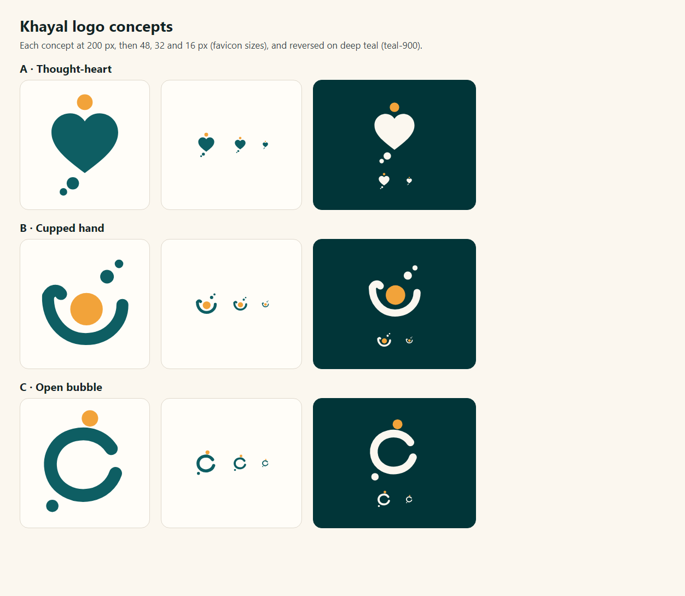
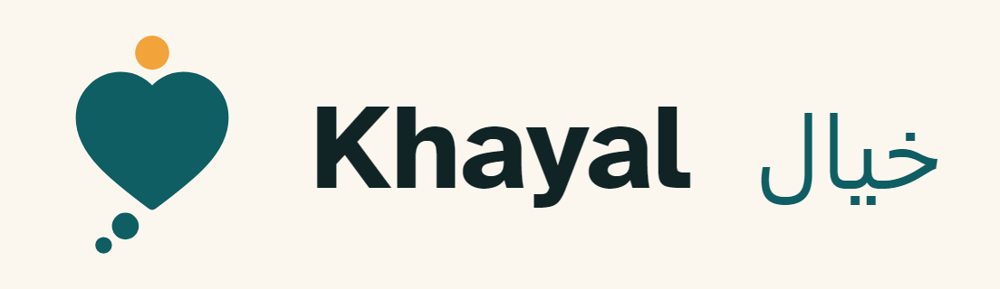
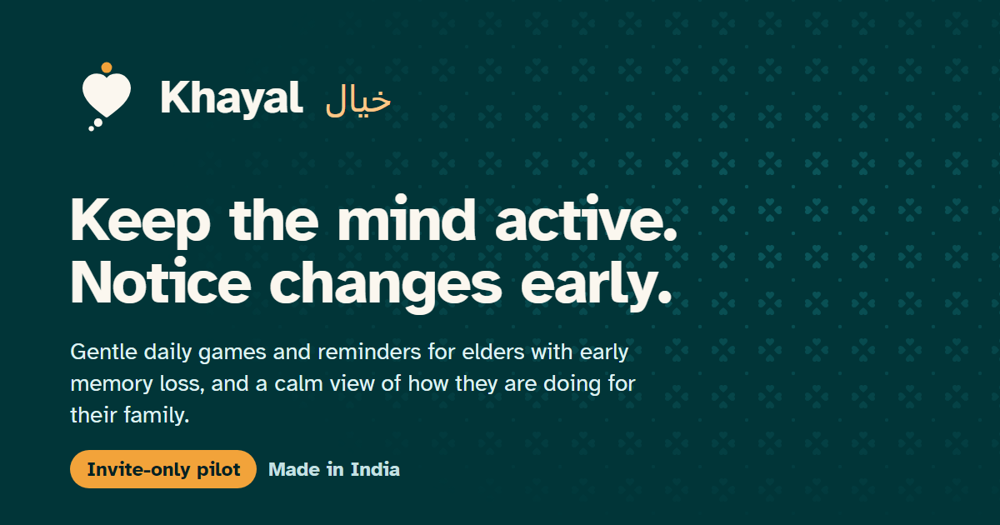

# Khayal logo: three concepts

Brief (CLAUDE.md section 11): an original mark for "thought + care", a soft thought bubble whose
shape also reads as a heart or a cupped hand, in deep teal with a small saffron dot like the dot
of خ. All three concepts below were drawn for Khayal as SVG; none copies or traces an existing brand.

| | Concept | Idea | At 16-32 px | Risk |
|---|---|---|---|---|
| A | **Thought-heart** ([svg](concepts/concept-a-thought-heart.svg)) | A heart whose point dissolves into a thought bubble's trail; the saffron dot sits above the dip like the dot of خ. | Reads at once as a heart with a dot. | Hearts are common in health and care brands; the trail and the dot have to carry the difference. |
| B | **Cupped hand** ([svg](concepts/concept-b-cupped-hand.svg)) | A cupped hand holding a saffron thought, with two bubbles rising. | The bowl survives; the bubbles blur. | A dot inside a curve can read as a smiling face, which is the childish look PRODUCT.md rules out. |
| C | **Open bubble** ([svg](concepts/concept-c-open-bubble.svg)) | One stroke: a thought bubble left open like a palm (and the bowl of خ), dot above, one bubble trailing. | Reads as a Latin "C" with a dot. | Too close to a plain letter; the "care" reading needs explanation. |

## Recommendation: A, softened

Concept A is the clearest "thought + care" at every size, including the 16 px favicon, and it
holds up reversed on teal. To keep it from being a generic heart, the final mark:

- softens the outline (rounded point and dip), so it reads as a soft bubble as much as a heart;
- keeps the two trail bubbles, which make it a thought, not only a feeling;
- keeps the saffron dot above the dip, the nuqta of خ, the one warm accent in the mark.

This is the mark in use for now; Phase B can revisit it.

## The final logo set

| File | Use |
|---|---|
| [`logo/khayal-mark.svg`](logo/khayal-mark.svg) | The mark in colour (teal + saffron) |
| [`logo/khayal-mark-mono.svg`](logo/khayal-mark-mono.svg) | The mark in one colour (ink), for print and stamps |
| [`logo/khayal-mark-reversed.svg`](logo/khayal-mark-reversed.svg) | The mark on deep teal (ivory + saffron) |
| [`logo/khayal-logo.svg`](logo/khayal-logo.svg) | Full logo: mark + "Khayal" + "خیال" ([preview](logo/khayal-logo.png)) |
| [`logo/khayal-logo-mono.svg`](logo/khayal-logo-mono.svg) | Full logo in one colour |
| [`logo/khayal-logo-reversed.svg`](logo/khayal-logo-reversed.svg) | Full logo on deep teal ([preview](logo/khayal-logo-reversed.png)) |
| `frontend/public/favicon.svg`, `favicon-32.png` | Browser tab icon |
| `frontend/public/apple-touch-icon.png` (180), `icon-512.png` | Home-screen icons (ivory ground) |
| `frontend/public/og-image.png` (1200 × 630) | Link previews |

**Provenance:** every file above is original vector artwork drawn for Khayal in this repository.
The PNGs were rendered from those SVGs with headless Chrome and resized with Pillow; no image
generator, stock art or traced artwork was used.

**Wordmark text is live text, not outlines (yet):** "Khayal" is set in Atkinson Hyperlegible
(Bold), the brand face the app already ships, and "خیال" uses the reader's own Nastaliq/Naskh font.
On the website both render with real fonts. In the stand-alone SVG files they fall back to the
viewer's fonts, so for print or for third parties, outline them first: that needs an
open-licensed Urdu font file (for example Noto Nastaliq Urdu, SIL OFL), which is not in the
repository yet.
