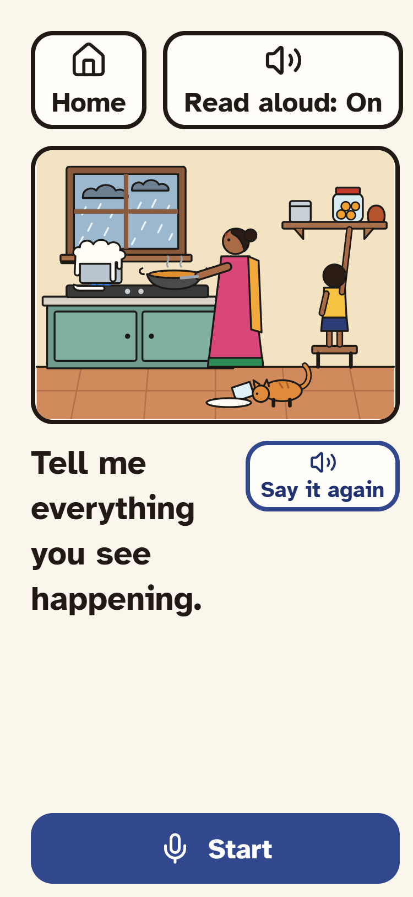
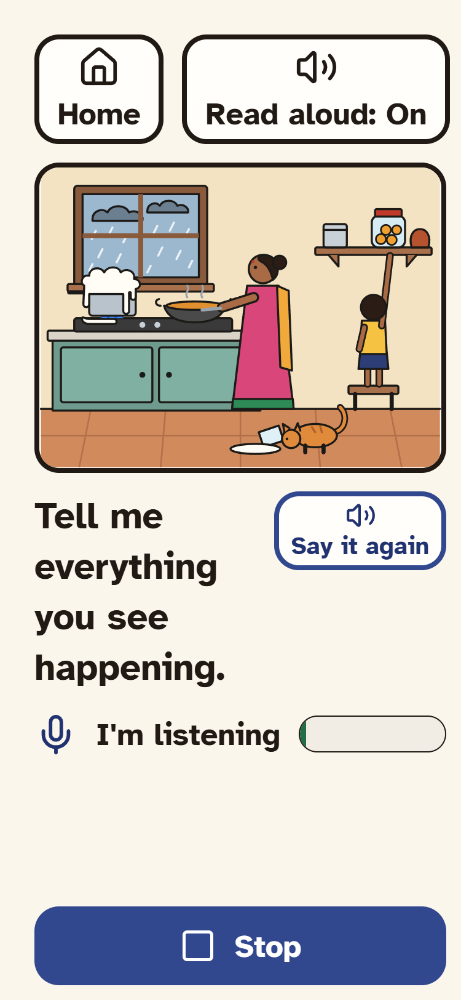
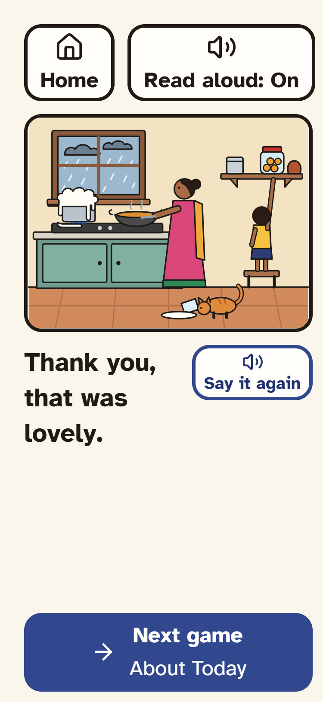
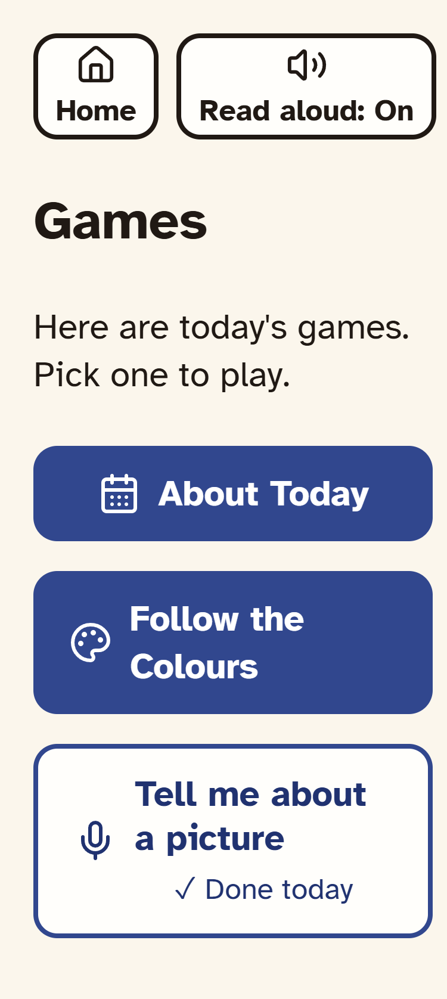
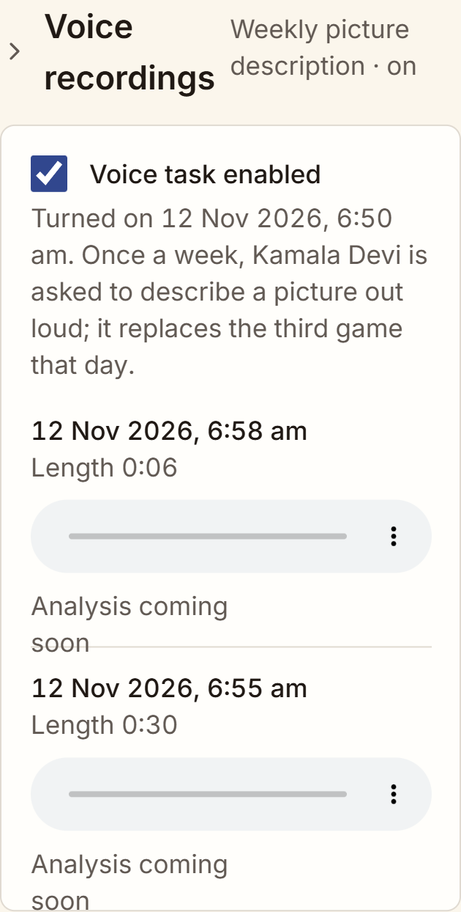

# Milestone 8: voice task screenshots

All shots are 375 × 812 with Read aloud on, signed in as Kamala (the demo patient with the voice task turned on). For the recording shots, a test tone stood in for the microphone; it went through the real recorder, upload and stub.

| Screen | Shot |
|---|---|
| Tell me about a picture: picture, instruction, Start |  |
| Recording: Stop and the sound-level bar, no countdown |  |
| After Stop: saved, "Thank you, that was lovely.", Next game |  |
| Today's games: the voice task in slot 3, done today |  |
| Caregiver: Voice recordings (consent toggle, date, length, playback, "Analysis coming soon") |  |

Notes:
- The playback controls are the browser's own `<audio>` element. The screenshot renderer draws them as an empty grey bar.
- Caregiver times are shown in the browser's time zone. The screenshot browser ran in UTC, so 12:20 IST shows as 6:50 am.
