# UI audit, batch 2: before and after (375 × 812)

**How the screenshots were made**
- The "before" shots are the latest captures of the same screens: from the audit, or from batch 1 for Memory Match and Word Recall.
- The "after" shots are rendered from the page at 2×.
- The caregiver shots (Pair a device, status icons) are cut from the patient page and the dashboard at 375px.

| Screen | Before | After |
|---|---|---|
| Start page (not signed in) | 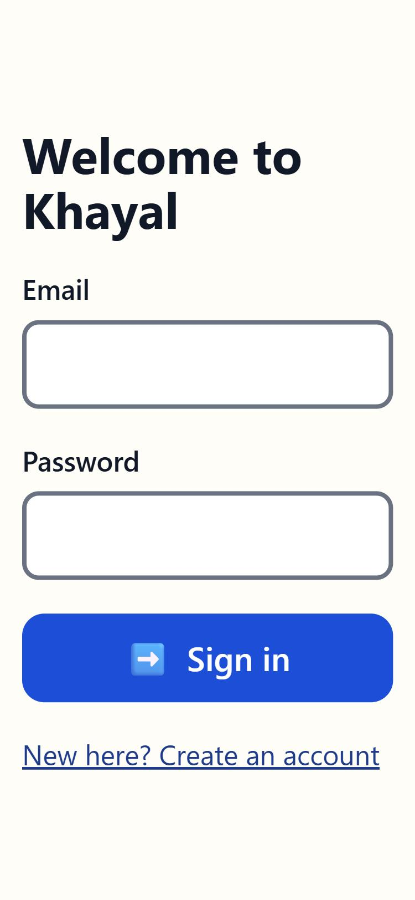 | 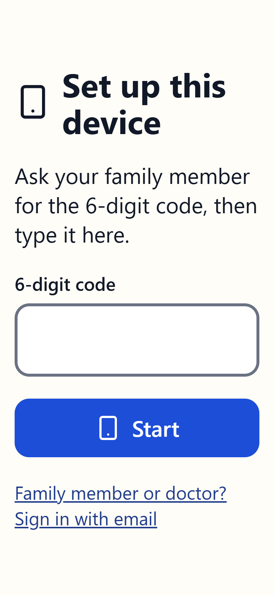 |
| Patient Home | 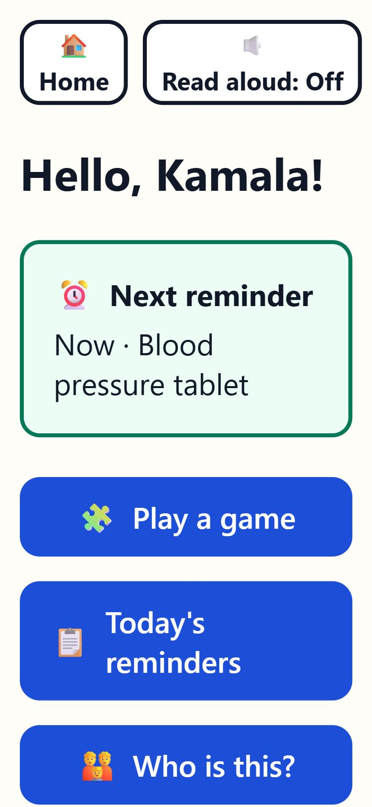 | 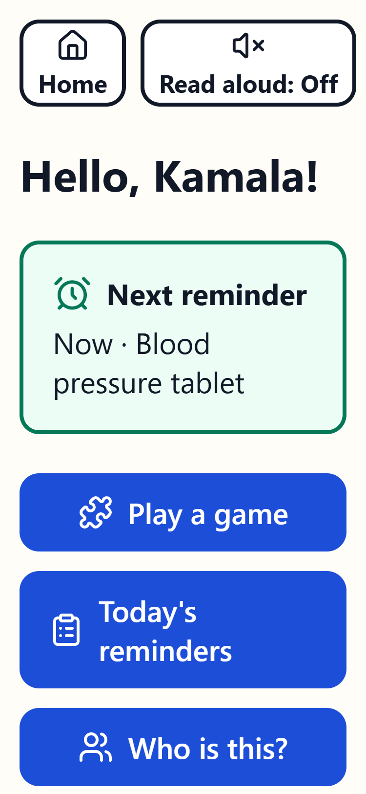 |
| Today's games | 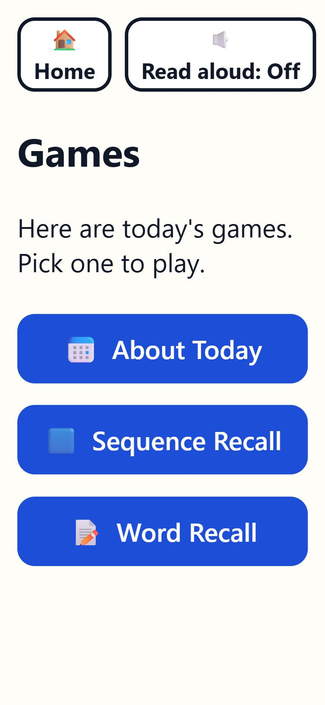 | 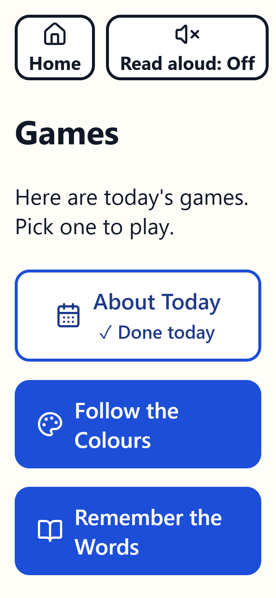 |
| Find the Pairs, 5 pairs | 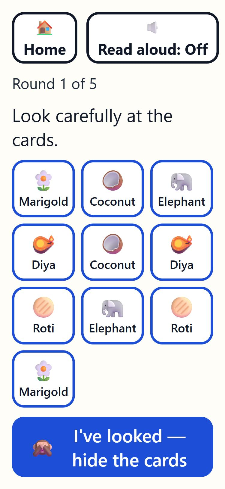 | 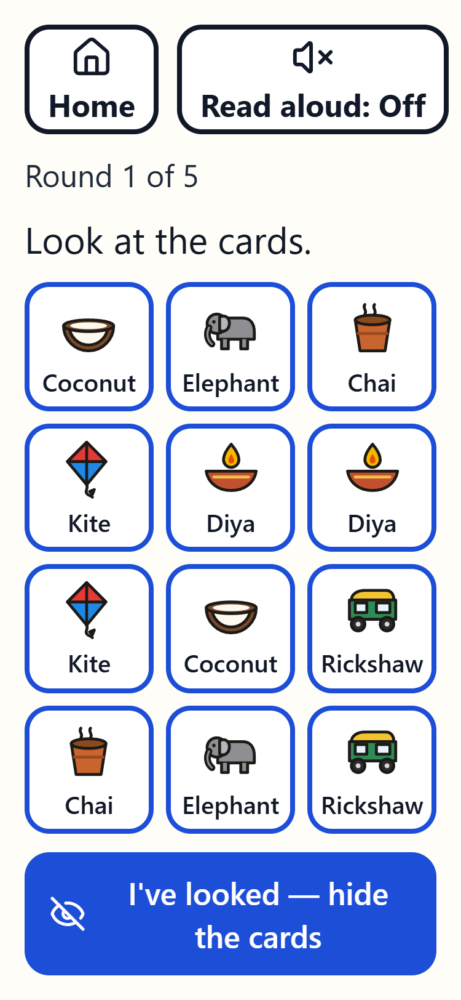 |
| Find the Pairs, 10 pairs | — | 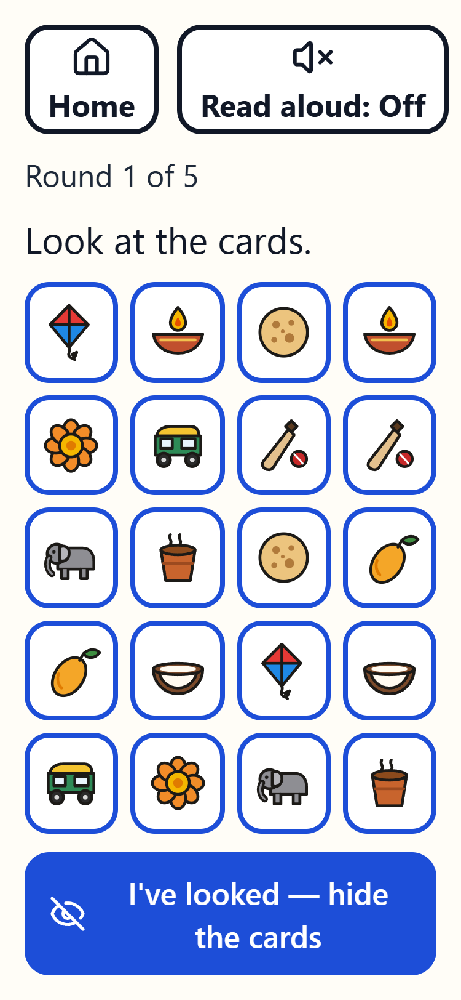 |
| Remember the Words, level 10 | 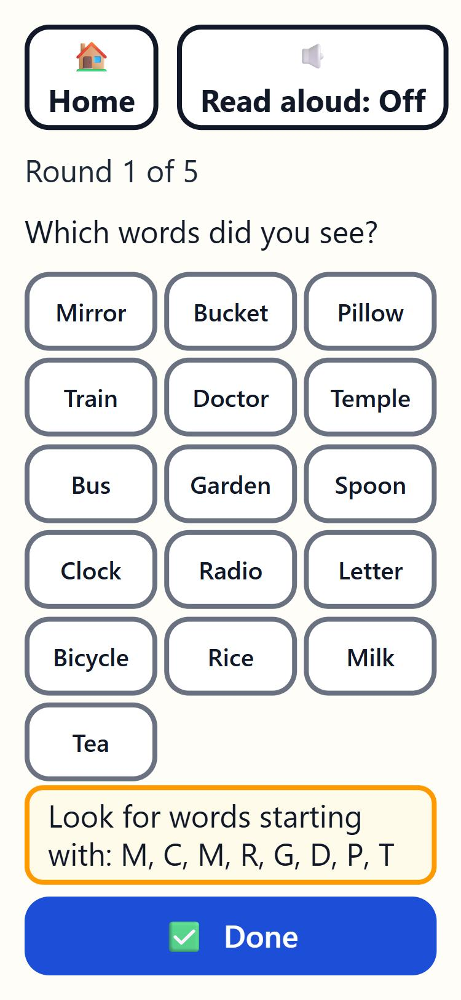 | 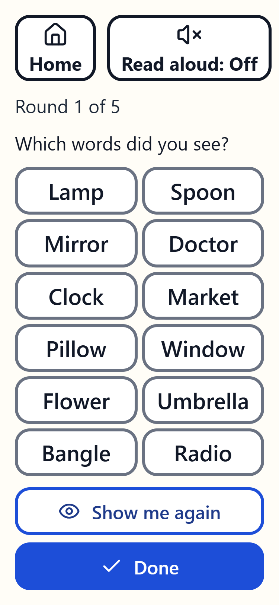 |
| End of a session | 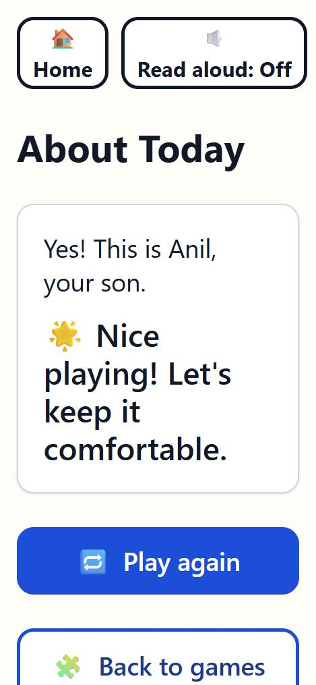 | 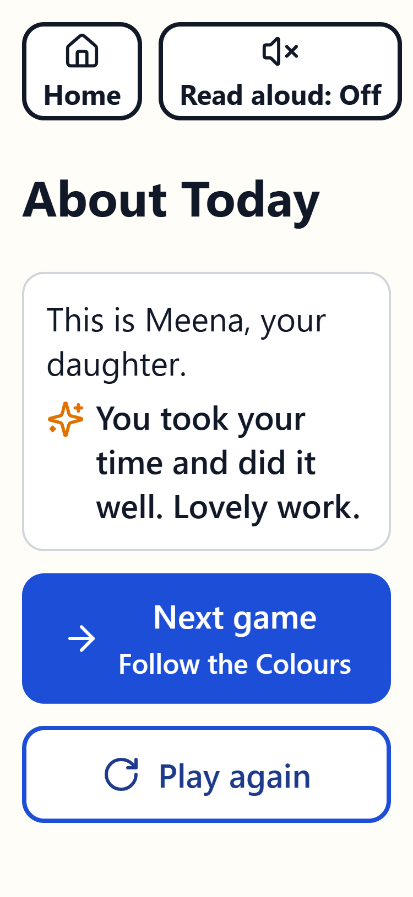 |
| Today's reminders | 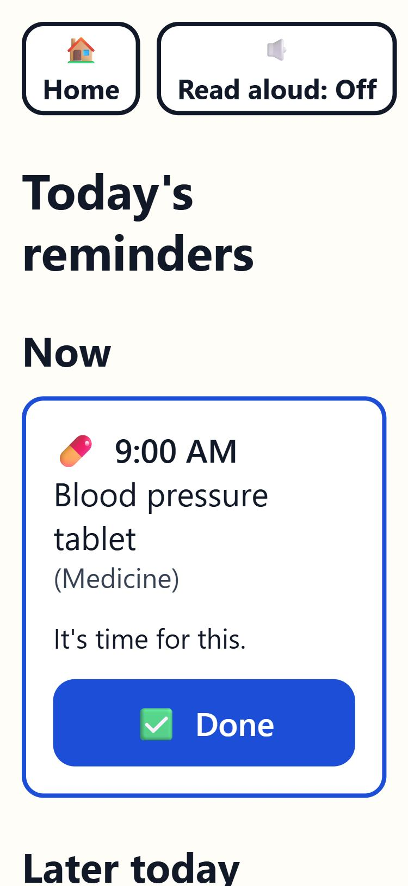 | 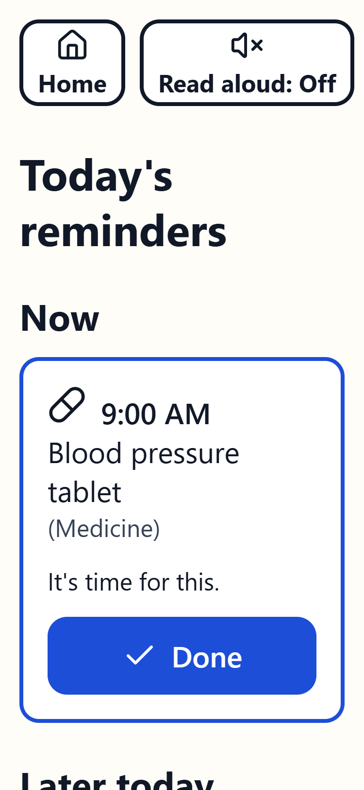 |
| Caregiver: Pair a device | — | 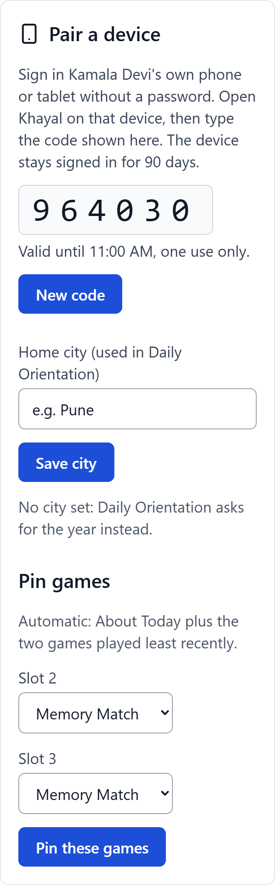 |
| Caregiver: status | — | 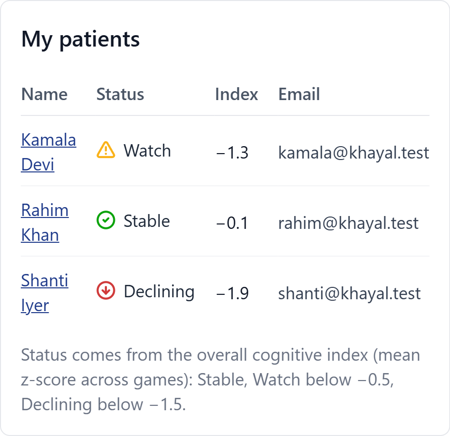 |

## What changed

**No emoji anywhere**
- Interface icons are `lucide-react` icons in one stroke style, always next to words: Home, Read aloud, the Home buttons, games, reminder types, hints and actions.
- On the caregiver side, status uses a different shape and colour per state: a check (Stable), a triangle (Watch / Warning), a down arrow (Declining) and an octagon (Critical).
- The Memory Match cards use 10 flat SVG illustrations in one style, in `frontend/src/games/memory/art/`: a 64-unit grid, a 3px dark outline and flat fills. They stay recognisable at about 60px, and 4-column boards show the picture alone.
- Only ✓ and ● remain, plus the ↑ → ↓ level changes in the caregiver session table, because they carry meaning.

**Read aloud in games**
- When Read aloud is on, each question is spoken with its choices (for example "What day of the week is it today? Thursday, Friday, Monday, or Saturday?").
- Each Word Recall word is spoken, and so is the kind reply after an answer.
- On the end screen, the last reply is spoken together with the encouragement.
- The voice language is Indian English (`en-IN`).

**Device pairing**
- On the caregiver's patient page, "Pair a device" shows a 6-digit code. The code is valid for 10 minutes and works once; a new code replaces the old one.
- A device that isn't signed in opens on "Set up this device". Entering the code signs it in as the patient for 90 days.
- Caregivers still sign in with email from a link on that page.
- After 10 wrong codes from one address, pairing pauses for 10 minutes.
- Codes are stored only as a keyed hash.

**Remember the Words**
- The pick list has at most 12 words: every word shown, plus new ones up to 12.
- At level 10 that is 8 + 4 words, in two columns of large type.

**End of a session**
- A varied, warm message replaces "Let's keep it comfortable". When the game will be harder next time, a gentle note says so.
- The main button is "Next game", naming the next unfinished game on today's list. When everything is done, it is "Back to Home". "Play again" is the second choice.
- Every button fits on screen.

**Game names**
- Patients now see "Find the Pairs", "Follow the Colours", "Remember the Words", "About Today" and "Tap When Green".
- Caregiver screens keep the clinical names.
