# UI audit, batch 4: before and after

Patient screens are 375 × 812, except Home, which is checked at 375 × 667 (a small phone). Caregiver screens are 1280 wide. All shots have Read aloud turned on. Every shot is rendered from the page with the same tool, before and after.

| Screen | Before | After |
|---|---|---|
| Patient Home, 375 × 667 | 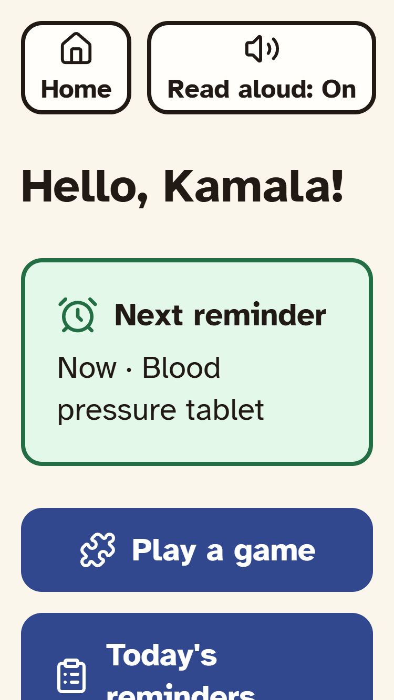 | 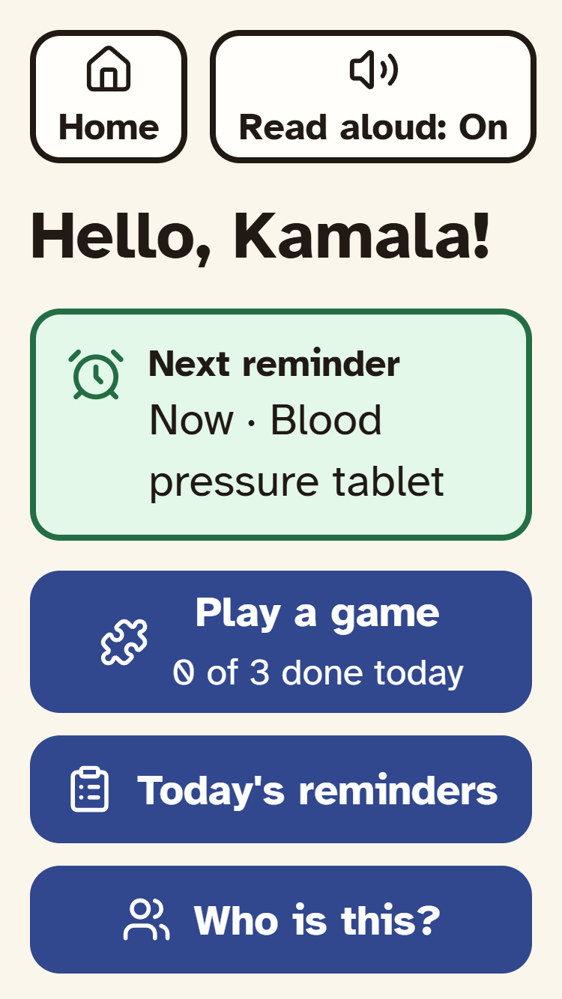 |
| Today's games | 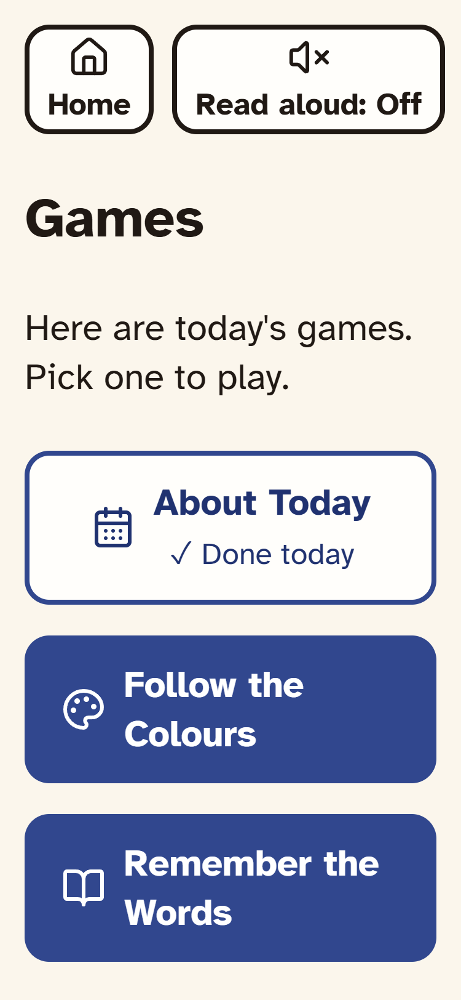 | 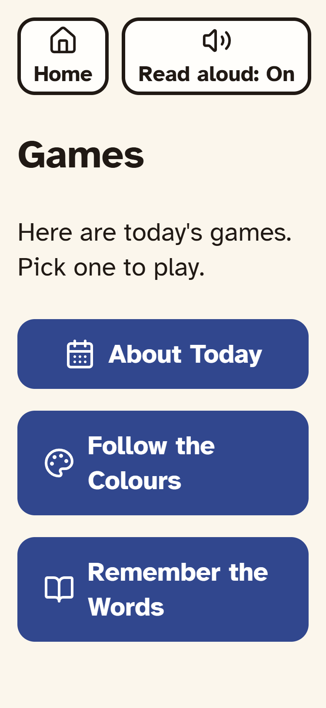 |
| Tap When Green, green | 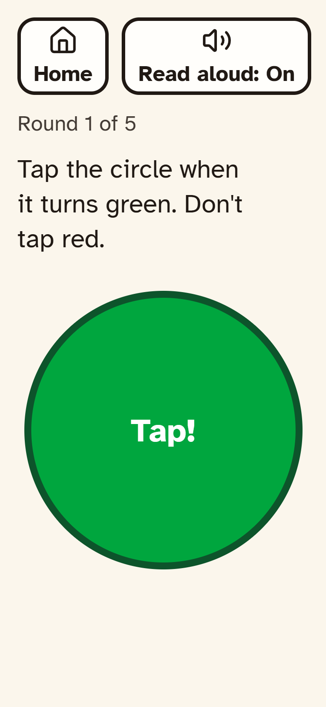 | 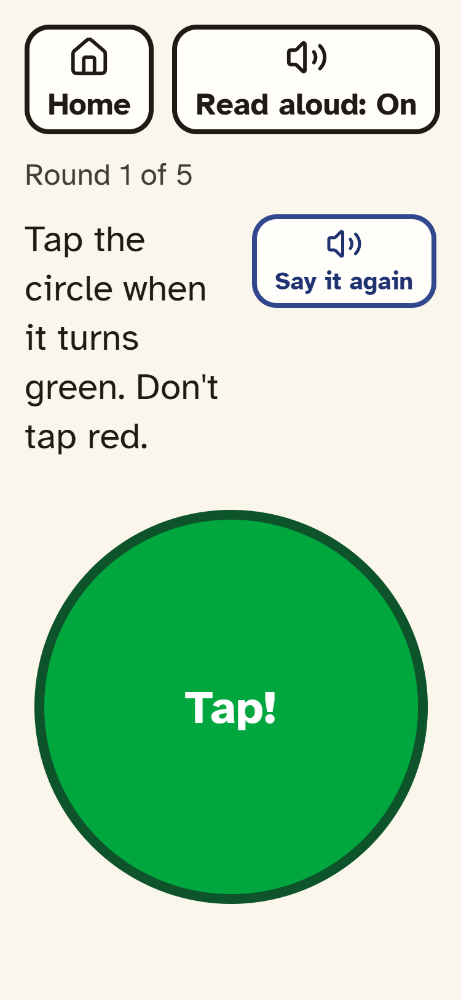 |
| Tap When Green, red | 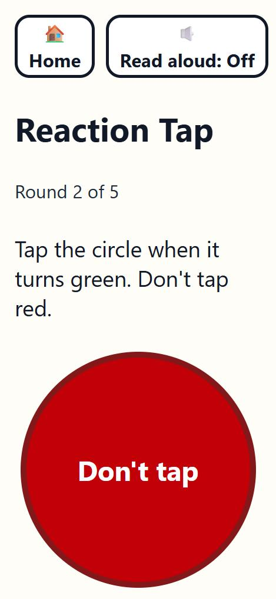 | 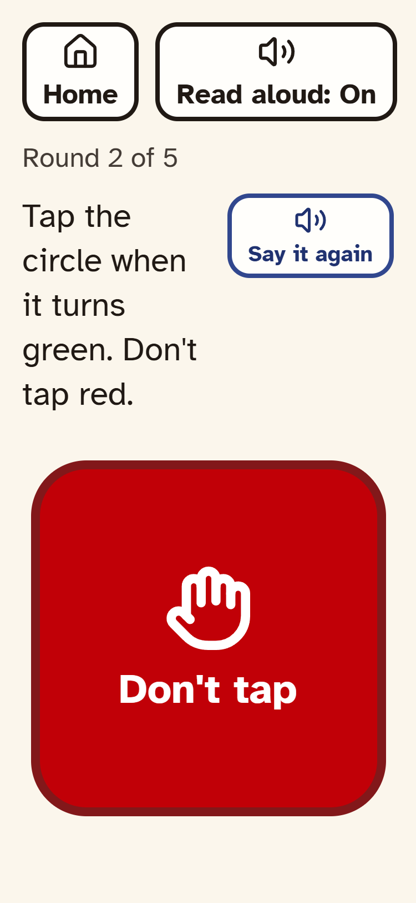 |
| About Today, a question | 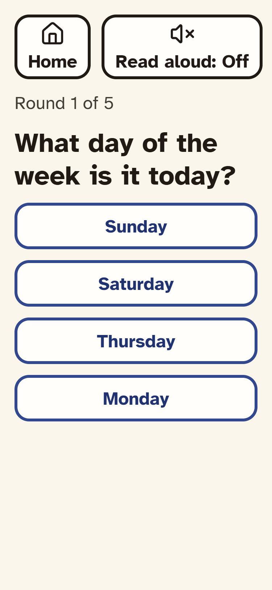 | 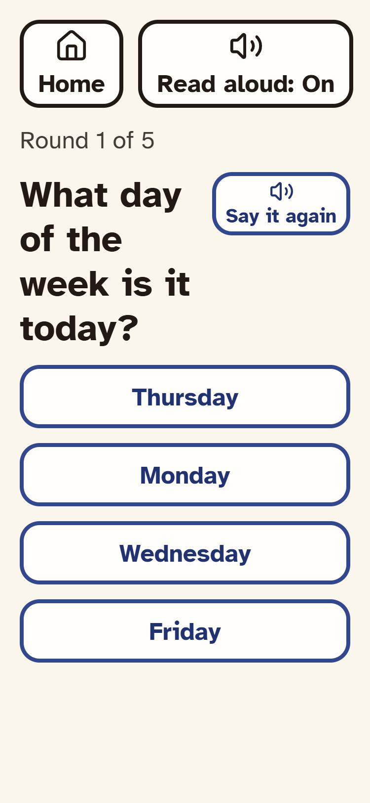 |
| Find the Pairs, preview | | 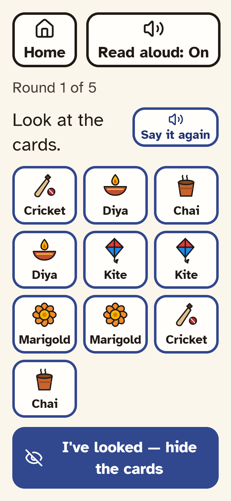 |
| Remember the Words, 12-word pick list (level 10) | | 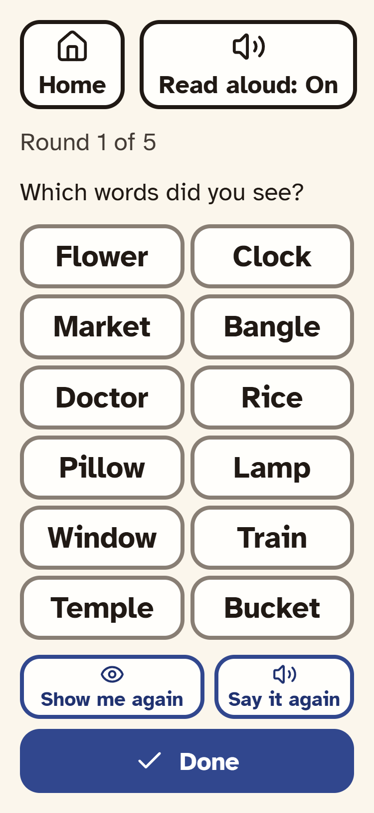 |
| Who is this? photo | 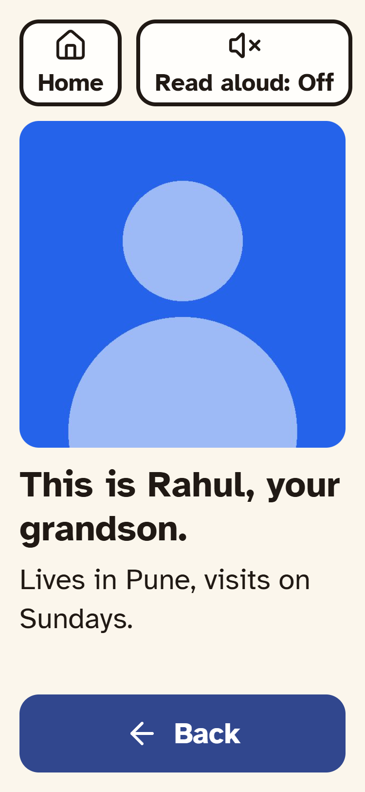 | 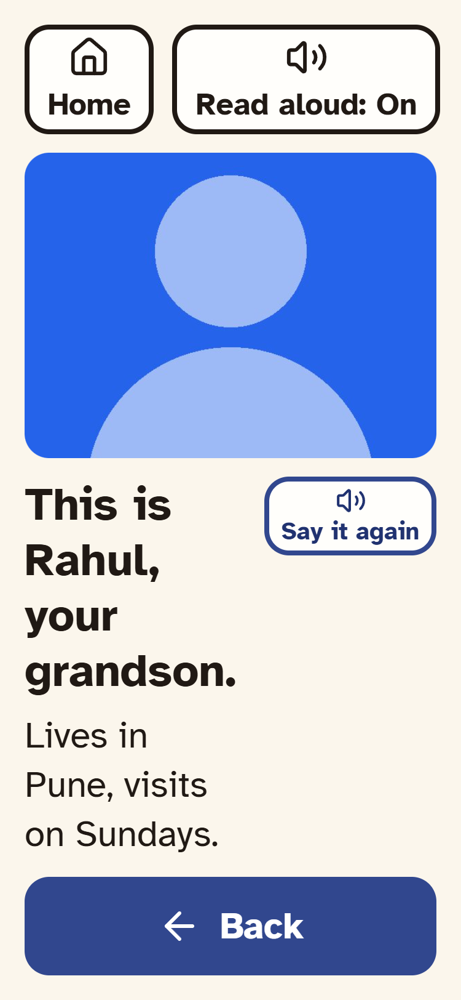 |
| Caregiver patient page, declining patient | 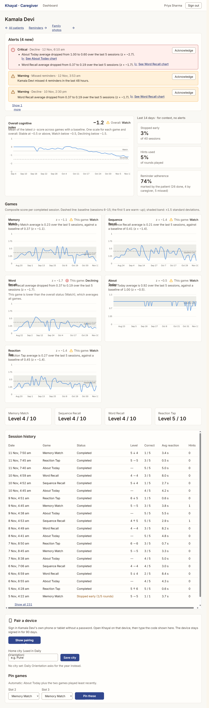 | 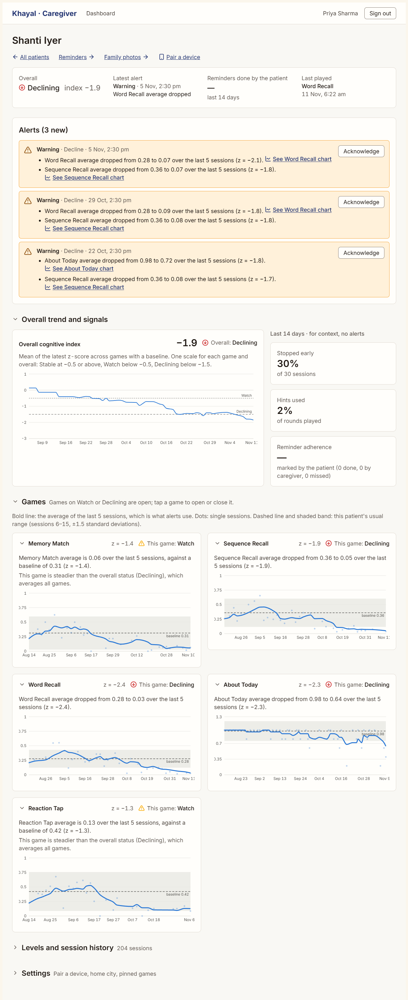 |
| Caregiver patient page, stable patient | | 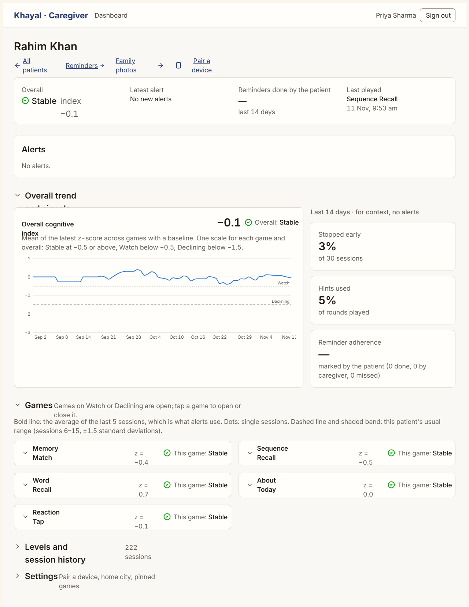 |

## What changed

**Tap When Green, not colour alone**
- Green is a circle that says "Tap!".
- Red is a rounded square with a hand-stop icon and "Don't tap". The red colour stays.

**Patient Home fits 375 × 667**
- The Next reminder card is one compact row: icon, label, and the reminder.
- "Play a game" carries today's progress as a status line ("2 of 3 done today").
- The three buttons are 72 px tall. The last one ends at 650 px.

**Read aloud: "Say it again"**
- When Read aloud is on, a "Say it again" button (icon above words, 64 px tall) sits next to the question in every game and next to the name on the Who is this? photo. When Read aloud is off, it is not shown.
- On Remember the Words' pick list, the button above the list pushed the 12th row 40 px under the fold. There it shares the row with "Show me again", above Done, so all 12 words, both buttons and Done fit at 375 × 812 (measured: the grid needs 414 px and gets 415).
- The two Tap When Green shots were taken before the button was trimmed from 76 to 64 px. The rest of the screen is unchanged.

**Caregiver charts**
- The bold line is the 5-session average, which is what the alerts use. Single sessions are faint dots. The baseline stays dashed with its ±1.5 std band.
- The tooltip names both: "5-session average" and "This session".

**Caregiver patient page**
- A summary card at the top: overall status and index, the latest new alert, reminders done by the patient (last 14 days), and the last game played.
- Alerts are always shown. The other parts are collapsible sections: Overall trend and signals (open), Games (open), Levels and session history (closed), Settings (closed). "Pair a device" opens Settings.
- Each game is its own collapsible card. Cards open by default only when the game is on Watch or Declining; a closed card still shows its name, z and status. An alert's "See … chart" link opens the card before scrolling to it.

## Alert rule B

The app now alerts with rule B by default: a game alerts only when its z has been below −1.5 on 3 consecutive completed sessions. A–E stay selectable with `KHAYAL_ALERT_RULE` for the evaluation. The demo history was regenerated under rule B (`python -m app.seed --demo-history --reset`, after backing up `data/khayal.db`): Shanti (moderate) has 3 decline warnings; Kamala (MCI) and Rahim (healthy) have none.
