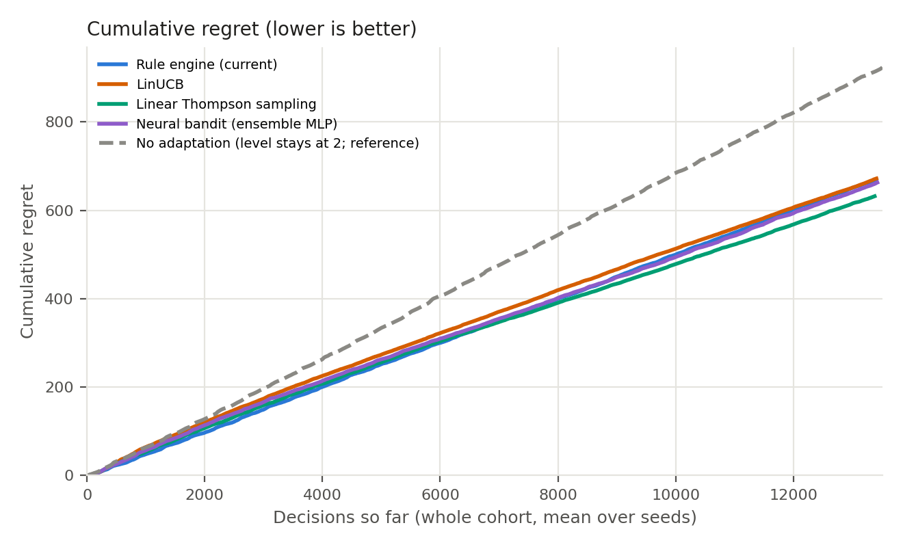
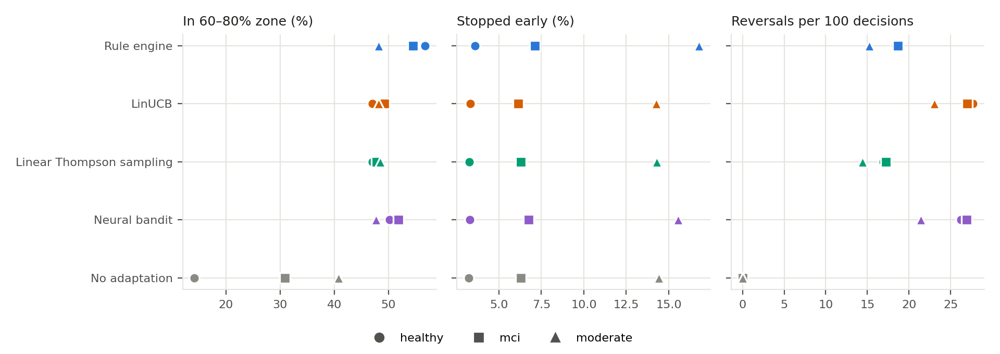
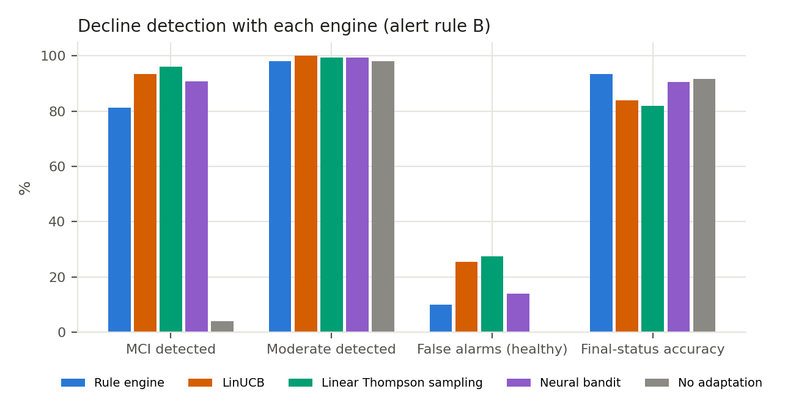

# Learning-based difficulty: bandits vs the rule engine

Generated by `python -m ml.adaptive.evaluate --patients-per-profile 30 --seeds 5 --days 90 --frustration 0.6` (from `ml/.venv`).

150 simulated patients per profile (30 × 5 seeds), 90 days, the default core set. Each engine starts untrained on every seed and learns online across the cohort. Frustration 0.6: the chance of stopping early rises by 0.6 × how far the expected success rate is below 60%, the same for every engine. Reward: 1 − |s − 0.70| / 0.30 (clipped to −1..1) for the next session's success rate s, minus 0.5 if it was stopped early. Regret uses the simulator's true ability on the day. ± is the standard deviation across seeds.

## Difficulty

| Engine | In 60–80% zone | Stopped early | Level changes / 100 | Reversals / 100 | Regret / decision | Cumulative regret / patient | Decided by the bandit |
|---|---|---|---|---|---|---|---|
| Rule engine (current) | 53.7% ± 0.2 | 8.7% ± 0.3 | 41.3 | 17.6 | 0.0501 ± 0.0009 | 7.51 | — |
| LinUCB | 48.1% ± 1.6 | 7.6% ± 0.5 | 53.8 | 26.1 | 0.0501 ± 0.0047 | 7.48 | 90.2% |
| Linear Thompson sampling | 47.7% ± 1.5 | 7.6% ± 0.3 | 38.8 | 16.3 | 0.0472 ± 0.0030 | 7.09 | 92.0% |
| Neural bandit (ensemble MLP) | 50.1% ± 0.4 | 8.1% ± 0.2 | 52.7 | 25.0 | 0.0494 ± 0.0028 | 7.41 | 85.3% |
| No adaptation (level stays at 2; reference) | 27.4% ± 0.8 | 7.6% ± 0.2 | 0.0 | 0.0 | 0.0685 ± 0.0013 | 10.33 | — |

### By profile

| Engine | Profile | In zone | Stopped early | Reversals / 100 | Regret / decision | Final level | Level change (first → last 15 days) | Success change |
|---|---|---|---|---|---|---|---|---|
| Rule engine (current) | healthy | 56.7% | 3.6% | 18.4 | 0.0372 | 7.4 | +3.46 | -21.7 pts |
| Rule engine (current) | mci | 54.6% | 7.1% | 18.7 | 0.0492 | 4.2 | +0.56 | -24.6 pts |
| Rule engine (current) | moderate | 48.2% | 16.8% | 15.2 | 0.0667 | 1.3 | -1.87 | -36.9 pts |
| LinUCB | healthy | 47.0% | 3.3% | 27.7 | 0.0499 | 5.9 | +2.39 | -12.1 pts |
| LinUCB | mci | 49.3% | 6.1% | 27.0 | 0.0505 | 3.0 | -0.17 | -15.9 pts |
| LinUCB | moderate | 48.2% | 14.3% | 23.1 | 0.0497 | 1.2 | -1.84 | -33.8 pts |
| Linear Thompson sampling | healthy | 47.0% | 3.3% | 16.9 | 0.0467 | 5.9 | +2.74 | -13.0 pts |
| Linear Thompson sampling | mci | 47.8% | 6.3% | 17.2 | 0.0502 | 2.6 | -0.21 | -13.7 pts |
| Linear Thompson sampling | moderate | 48.5% | 14.3% | 14.4 | 0.0444 | 1.1 | -1.72 | -34.2 pts |
| Neural bandit (ensemble MLP) | healthy | 50.2% | 3.3% | 26.2 | 0.0447 | 6.4 | +2.48 | -12.9 pts |
| Neural bandit (ensemble MLP) | mci | 51.8% | 6.8% | 26.9 | 0.0485 | 3.4 | +0.15 | -18.7 pts |
| Neural bandit (ensemble MLP) | moderate | 47.8% | 15.5% | 21.4 | 0.0560 | 1.3 | -1.78 | -37.3 pts |
| No adaptation (level stays at 2; reference) | healthy | 14.2% | 3.2% | 0.0 | 0.0498 | 2.0 | +0.00 | -0.2 pts |
| No adaptation (level stays at 2; reference) | mci | 30.8% | 6.3% | 0.0 | 0.0674 | 2.0 | +0.00 | -10.3 pts |
| No adaptation (level stays at 2; reference) | moderate | 40.8% | 14.4% | 0.0 | 0.0921 | 2.0 | +0.00 | -46.3 pts |

## Does adaptive difficulty hide decline?

The decline replay of `ml.decline.evaluate` (current settings, alert rule B) on each engine's sessions. The last row is the rule engine without frustration (the default simulator of `decline_eval.md`): frustration (0.6) changes how often patients stop early, and so the numbers.

| Engine | Final-status accuracy | False alarms (healthy) | MCI detected | MCI delay, days | Moderate detected | Moderate delay, days |
|---|---|---|---|---|---|---|
| Rule engine (current) | 0.933 ± 0.021 | 0.100 | 0.813 | 70 (IQR 61–78) | 0.980 | 67 (IQR 61–74) |
| LinUCB | 0.840 ± 0.026 | 0.253 | 0.933 | 60 (IQR 52–70) | 1.000 | 61 (IQR 57–69) |
| Linear Thompson sampling | 0.820 ± 0.062 | 0.273 | 0.960 | 60 (IQR 53–68) | 0.993 | 61 (IQR 55–67) |
| Neural bandit (ensemble MLP) | 0.904 ± 0.017 | 0.140 | 0.907 | 63 (IQR 53–75) | 0.993 | 63 (IQR 58–68) |
| No adaptation (level stays at 2; reference) | 0.916 ± 0.017 | 0.000 | 0.040 | 84 (IQR 80–87) | 0.980 | 70 (IQR 64–76) |
| Rule engine, no frustration (reference) | 0.942 ± 0.014 | 0.127 | 0.773 | 70 (IQR 60–81) | 0.993 | 65 (IQR 58–72) |

## Findings (computed)

- LinUCB: zone 48.1% vs 53.7% for the rule engine, stopped early 7.6% vs 8.7%, regret per decision 0.0501 vs 0.0501, reversals 26.1 vs 17.6 per 100; decline accuracy 0.840 vs 0.933, MCI detected 0.933 vs 0.813, false alarms 0.253 vs 0.100.
- Linear Thompson sampling: zone 47.7% vs 53.7% for the rule engine, stopped early 7.6% vs 8.7%, regret per decision 0.0472 vs 0.0501, reversals 16.3 vs 17.6 per 100; decline accuracy 0.820 vs 0.933, MCI detected 0.960 vs 0.813, false alarms 0.273 vs 0.100.
- Neural bandit (ensemble MLP): zone 50.1% vs 53.7% for the rule engine, stopped early 8.1% vs 8.7%, regret per decision 0.0494 vs 0.0501, reversals 25.0 vs 17.6 per 100; decline accuracy 0.904 vs 0.933, MCI detected 0.907 vs 0.813, false alarms 0.140 vs 0.100.
- LinUCB does not hide decline but exaggerates it: more MCI patients detected and more false alarms among healthy patients. Its MCI patients' level moves -0.73 levels more than with the rule engine from the first to the last 15 days (the composite multiplies accuracy by level, so a level that falls faster makes decline look larger).
- Linear Thompson sampling does not hide decline but exaggerates it: more MCI patients detected and more false alarms among healthy patients. Its MCI patients' level moves -0.76 levels more than with the rule engine from the first to the last 15 days (the composite multiplies accuracy by level, so a level that falls faster makes decline look larger).
- Neural bandit (ensemble MLP) does not hide decline but exaggerates it: more MCI patients detected and more false alarms among healthy patients. Its MCI patients' level moves -0.40 levels more than with the rule engine from the first to the last 15 days (the composite multiplies accuracy by level, so a level that falls faster makes decline look larger).
- Lowest regret among the bandits: Linear Thompson sampling.
- No adaptation (reference): zone 27.4%, MCI detected 0.040, false alarms 0.000.

## Interpretation

The composite score (accuracy × level / 10 × reaction-time ratio) couples difficulty adaptation and decline tracking: the level an engine chooses is part of the signal that decline tracking reads. An engine that keeps accuracy in the target zone moves the decline signal into the level, so how quickly it lowers the level decides how large a decline looks. The bandits lower declining patients' levels faster than the rule engine, so they do not hide decline but exaggerate it: more MCI patients are detected, at the cost of more false alarms in healthy patients. This is why production keeps `KHAYAL_ADAPTIVE_ENGINE=rule`. Future work: a level-independent ability estimate (Elo- or IRT-style, rating the patient against the difficulty of each round) as the tracked score, so that decline tracking gives the same answer whichever engine picks the levels.

## Run time

| Engine | Decisions | Seconds |
|---|---|---|
| Rule engine (current) | 67510 | 66 |
| LinUCB | 67222 | 66 |
| Linear Thompson sampling | 67574 | 43 |
| Neural bandit (ensemble MLP) | 67506 | 327 |
| No adaptation (level stays at 2; reference) | 67882 | 27 |

Rule engine baseline for comparison: 67510 decisions.
