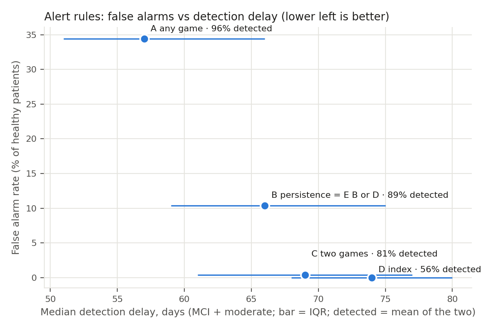

# Decline detection on simulated patients

Generated by `python -m ml.decline.evaluate --patients-per-profile 50 --seeds 5 --days 90`.

250 simulated patients per profile (50 × 5 seeds), 90 days each, from `ml.decline.simulator` (rounds pass through the real adaptive engine). The decline rule is replayed each evening as in the backend. Decline starts on day 0, so the detection delay is the day of the first decline alert (warning or critical). Final status is the overall cognitive index on the last day.

## Ablation

| Setting | Accuracy | False alarm rate (healthy) | MCI detected | MCI delay, days | Moderate detected | Moderate delay, days |
|---|---|---|---|---|---|---|
| current | 0.944 ± 0.015 | 0.104 ± 0.050 | 0.792 | 69 (IQR 60–80) | 0.988 | 65 (IQR 59–72) |
| legacy | 0.917 ± 0.034 | 0.572 ± 0.064 | 0.936 | 40 (IQR 22–59) | 1.000 | 36 (IQR 25–45) |

± is the standard deviation across seeds. Delays are median (IQR) over detected patients.

## Alert rule variants

Everything else as in the current settings (floors, clipping, warm-up, escalation, 7-day throttle). False alarm = a healthy patient with any decline alert. Alert accuracy = healthy patients without an alert plus mci/moderate patients with one, over all patients. Final-status accuracy is the same for every variant (0.944) because the final status comes from the index, not from the alerts.

| Variant | Rule | False alarm rate (healthy) | Alert accuracy | MCI detected | MCI delay, days | Moderate detected | Moderate delay, days |
|---|---|---|---|---|---|---|---|
| A | any game z < −1.5 (first rule) | 0.344 ± 0.026 | 0.860 | 0.924 | 59 (IQR 51–70) | 1.000 | 57 (IQR 51–64) |
| B | same game z < −1.5 on 3 consecutive sessions (current default) | 0.104 ± 0.050 | 0.892 | 0.792 | 69 (IQR 60–80) | 0.988 | 65 (IQR 59–72) |
| C | at least 2 games z < −1.5 at once | 0.004 ± 0.009 | 0.875 | 0.640 | 74 (IQR 65–81) | 0.988 | 67 (IQR 61–73) |
| D | overall index < −1.5 | 0.000 ± 0.000 | 0.708 | 0.160 | 80 (IQR 77–85) | 0.964 | 73 (IQR 67–79) |
| E | B or D | 0.104 ± 0.050 | 0.892 | 0.792 | 69 (IQR 60–80) | 0.988 | 65 (IQR 58–72) |

## Current (floor max(0.05, 0.15×mean), z clipped to ±4, 5-session warm-up, escalation)

Confusion matrix (rows: true profile, columns: final status):

| Profile | Stable | Watch | Declining |
|---|---|---|---|
| healthy | 247 | 3 | 0 |
| mci | 1 | 222 | 27 |
| moderate | 0 | 11 | 239 |

Accuracy: 0.944

| Class | Precision | Recall | F1 |
|---|---|---|---|
| Stable (healthy) | 0.996 | 0.988 | 0.992 |
| Watch (mci) | 0.941 | 0.888 | 0.914 |
| Declining (moderate) | 0.898 | 0.956 | 0.926 |

## Legacy (floor 0.02, no clipping, no warm-up, no escalation)

Confusion matrix (rows: true profile, columns: final status):

| Profile | Stable | Watch | Declining |
|---|---|---|---|
| healthy | 250 | 0 | 0 |
| mci | 14 | 189 | 47 |
| moderate | 0 | 1 | 249 |

Accuracy: 0.917

| Class | Precision | Recall | F1 |
|---|---|---|---|
| Stable (healthy) | 0.947 | 1.000 | 0.973 |
| Watch (mci) | 0.995 | 0.756 | 0.859 |
| Declining (moderate) | 0.841 | 0.996 | 0.912 |

