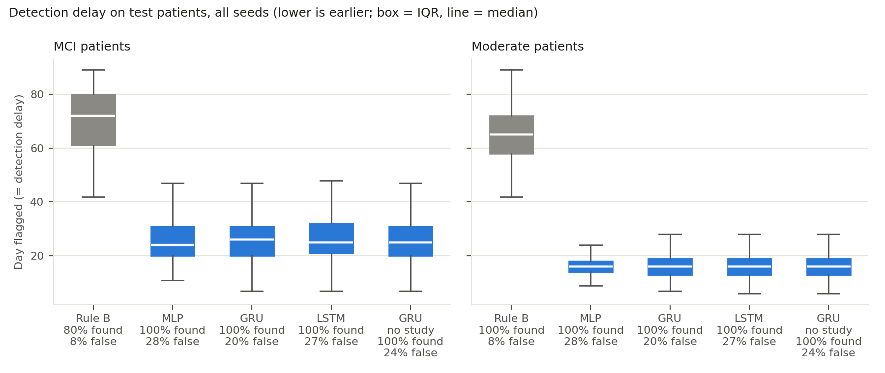
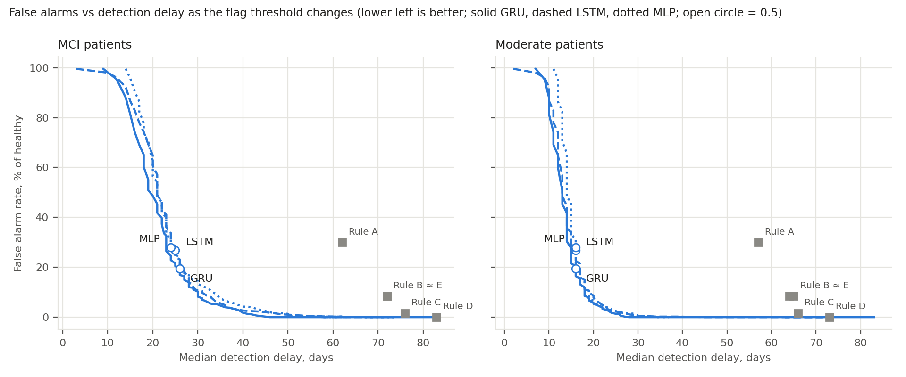
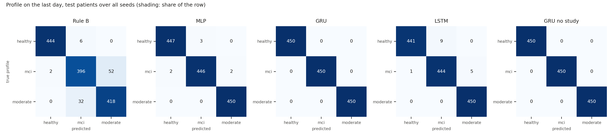
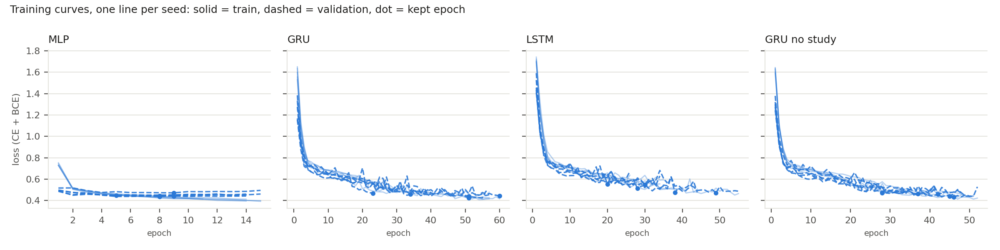

# Deep learning vs the rule for decline detection

Generated by `python -m ml.dl.run --per-profile 600 --days 90 --seeds 5`.

Each seed simulates a new cohort of 600 patients per profile (1800 in all, 90 days, `ml.decline.simulator`), split by patient into 1260 train / 270 validation / 270 test. Every method is scored on the same test patients. Values are mean ± standard deviation over 5 seeds (seed = cohort, split and model initialisation).

## Profile on the last day

Rule B's profile is the overall cognitive index status on the last day (Stable → healthy, Watch → mci, Declining → moderate; Learning counts as wrong). The models' profile is the profile head's most likely class after the last session.

| Method | Accuracy | Macro F1 | Recall healthy | Recall mci | Recall moderate |
|---|---|---|---|---|---|
| Rule B (app: same game z < −1.5 on 3 sessions in a row) | 0.932 ± 0.025 | 0.932 ± 0.026 | 0.987 ± 0.014 | 0.880 ± 0.068 | 0.929 ± 0.023 |
| MLP on summary features | 0.995 ± 0.004 | 0.995 ± 0.004 | 0.993 ± 0.006 | 0.991 ± 0.009 | 1.000 ± 0.000 |
| GRU (2 layers) | 1.000 ± 0.000 | 1.000 ± 0.000 | 1.000 ± 0.000 | 1.000 ± 0.000 | 1.000 ± 0.000 |
| LSTM (2 layers) | 0.989 ± 0.008 | 0.989 ± 0.008 | 0.980 ± 0.014 | 0.987 ± 0.020 | 1.000 ± 0.000 |
| GRU without study time | 1.000 ± 0.000 | 1.000 ± 0.000 | 1.000 ± 0.000 | 1.000 ± 0.000 | 1.000 ± 0.000 |

## Early warning at threshold 0.5

A model flags a patient on the day its P(decline) has been ≥ 0.5 for 3 days in a row (the day an alert could fire; days without play keep the last value). Rule B flags on the day of its first decline alert. Decline starts on day 0, so that day is the detection delay. False alarm = a healthy patient flagged at any time. Delay = median over flagged patients, then mean ± std over seeds.

| Method | False alarm rate (healthy) | False alarm day | MCI detected | MCI delay, days | Moderate detected | Moderate delay, days |
|---|---|---|---|---|---|---|
| Rule B (app: same game z < −1.5 on 3 sessions in a row) | 0.084 ± 0.022 | 62.5 ± 4.9 | 0.804 ± 0.061 | 71.7 ± 2.9 | 0.998 ± 0.005 | 64.4 ± 0.7 |
| MLP on summary features | 0.280 ± 0.034 | 27.1 ± 1.3 | 1.000 ± 0.000 | 24.1 ± 0.7 | 1.000 ± 0.000 | 15.9 ± 0.5 |
| GRU (2 layers) | 0.196 ± 0.037 | 28.6 ± 2.4 | 1.000 ± 0.000 | 25.4 ± 1.8 | 1.000 ± 0.000 | 15.8 ± 1.1 |
| LSTM (2 layers) | 0.269 ± 0.081 | 29.0 ± 2.6 | 1.000 ± 0.000 | 25.0 ± 1.6 | 1.000 ± 0.000 | 15.8 ± 1.0 |
| GRU without study time | 0.240 ± 0.032 | 29.5 ± 2.0 | 1.000 ± 0.000 | 24.5 ± 1.7 | 1.000 ± 0.000 | 15.6 ± 0.9 |

The models' delays depend on the early-warning target they were trained on (see Method: it switches on at day 23 for mci and day 10 for moderate), so they are not a pure measure of how early the data shows decline. The next table compares the methods without that target.

## How early each method tells the profile

Profile accuracy using only the sessions up to the given day (the rule: index status that evening; the models: their profile head after that day's play). No early-warning target is involved.

| Method | Day 14 | Day 30 | Day 60 | Day 89 |
|---|---|---|---|---|
| Rule B (app: same game z < −1.5 on 3 sessions in a row) | 0.057 ± 0.024 | 0.344 ± 0.009 | 0.551 ± 0.019 | 0.932 ± 0.025 |
| MLP on summary features | 0.685 ± 0.046 | 0.758 ± 0.016 | 0.967 ± 0.013 | 0.995 ± 0.004 |
| GRU (2 layers) | 0.643 ± 0.033 | 0.816 ± 0.028 | 0.984 ± 0.010 | 1.000 ± 0.000 |
| LSTM (2 layers) | 0.625 ± 0.062 | 0.796 ± 0.039 | 0.957 ± 0.020 | 0.989 ± 0.008 |
| GRU without study time | 0.635 ± 0.044 | 0.820 ± 0.024 | 0.984 ± 0.008 | 1.000 ± 0.000 |

## Early warning at a matched false-alarm rate

A threshold of 0.5 gives the models far more false alarms than the rule, so the delays above are not a like-for-like comparison. Here each model's flag threshold is chosen on the **validation** patients: the lowest threshold whose validation false-alarm rate is at most rule B's on the same validation patients (8.9% ± 2.8 over seeds). Test patients are scored at that threshold. Detected = recall of the flag for that profile within the 90 days.

| Method | Threshold | False alarm rate (test) | MCI delay, days (detected) | Moderate delay, days (detected) |
|---|---|---|---|---|
| Rule B (app: same game z < −1.5 on 3 sessions in a row) | — | 8.4% ± 2.2 | 71.7 ± 2.9 (80%) | 64.4 ± 0.7 (100%) |
| MLP on summary features | 0.8160 ± 0.0792 | 11.3% ± 3.9 | 31.9 ± 2.4 (100%) | 18.4 ± 0.9 (100%) |
| GRU (2 layers) | 0.7040 ± 0.1108 | 11.8% ± 3.1 | 29.2 ± 2.5 (100%) | 17.8 ± 0.8 (100%) |
| LSTM (2 layers) | 0.7640 ± 0.1565 | 11.6% ± 4.1 | 31.2 ± 5.2 (100%) | 18.8 ± 2.2 (100%) |
| GRU without study time | 0.7160 ± 0.0780 | 12.0% ± 5.3 | 28.3 ± 1.4 (100%) | 17.8 ± 0.8 (100%) |

The curves sweep the flag threshold (test patients, all seeds pooled; the open circle is threshold 0.5). The grey points are the rule's variants on the same patients: A = any game z < −1.5 (first rule); B = same game z < −1.5 on 3 consecutive sessions (current default); C = at least 2 games z < −1.5 at once; D = overall index < −1.5; E = B or D.

## Robustness: shifted simulators, no retraining

The models trained on the default simulator are tested on new patients from changed simulators (270 per seed, same size as the test split). The rule's settings are unchanged too. Thresholds are the ones matched on the default validation set. With a later onset, the delay counts from each patient's own onset, and a flag before the decline starts is not counted as detected.

**Profile**

| Test set | Method | Accuracy | Macro F1 | Day-14 accuracy |
|---|---|---|---|---|
| Default simulator (test split) | Rule B | 0.932 ± 0.025 | 0.932 ± 0.026 | 0.057 ± 0.024 |
| Default simulator (test split) | GRU | 1.000 ± 0.000 | 1.000 ± 0.000 | 0.643 ± 0.033 |
| Default simulator (test split) | MLP on summary features | 0.995 ± 0.004 | 0.995 ± 0.004 | 0.685 ± 0.046 |
| Decline starts later (day 30–50) | Rule B | 0.764 ± 0.025 | 0.754 ± 0.028 | 0.053 ± 0.006 |
| Decline starts later (day 30–50) | GRU | 0.704 ± 0.044 | 0.686 ± 0.054 | 0.491 ± 0.038 |
| Decline starts later (day 30–50) | MLP on summary features | 0.624 ± 0.028 | 0.575 ± 0.036 | 0.423 ± 0.024 |
| 1.5× day-to-day noise | Rule B | 0.896 ± 0.020 | 0.896 ± 0.020 | 0.040 ± 0.014 |
| 1.5× day-to-day noise | GRU | 0.994 ± 0.006 | 0.994 ± 0.006 | 0.673 ± 0.042 |
| 1.5× day-to-day noise | MLP on summary features | 0.996 ± 0.003 | 0.996 ± 0.003 | 0.719 ± 0.046 |
| Slower MCI decline (0.5× rate) | Rule B | 0.839 ± 0.018 | 0.834 ± 0.018 | 0.035 ± 0.009 |
| Slower MCI decline (0.5× rate) | GRU | 0.893 ± 0.043 | 0.889 ± 0.049 | 0.603 ± 0.059 |
| Slower MCI decline (0.5× rate) | MLP on summary features | 0.867 ± 0.010 | 0.862 ± 0.011 | 0.636 ± 0.047 |
| Plays every other day at most | Rule B | 0.566 ± 0.030 | 0.508 ± 0.040 | 0.000 ± 0.000 |
| Plays every other day at most | GRU | 0.369 ± 0.024 | 0.269 ± 0.029 | 0.333 ± 0.002 |
| Plays every other day at most | MLP on summary features | 0.339 ± 0.006 | 0.221 ± 0.013 | 0.354 ± 0.017 |
| Same noise and play rate for every profile (only the decline differs) | Rule B | 0.924 ± 0.015 | 0.924 ± 0.016 | 0.044 ± 0.013 |
| Same noise and play rate for every profile (only the decline differs) | GRU | 0.998 ± 0.005 | 0.998 ± 0.005 | 0.459 ± 0.035 |
| Same noise and play rate for every profile (only the decline differs) | MLP on summary features | 0.981 ± 0.009 | 0.981 ± 0.009 | 0.547 ± 0.021 |

**Early warning at the matched thresholds**

| Test set | Method | False alarm rate | MCI delay, days (detected) | Moderate delay, days (detected) | Flagged before onset |
|---|---|---|---|---|---|
| Default simulator (test split) | Rule B | 8.4% ± 2.2 | 71.7 ± 2.9 (80%) | 64.4 ± 0.7 (100%) | — |
| Default simulator (test split) | GRU | 11.8% ± 3.1 | 29.2 ± 2.5 (100%) | 17.8 ± 0.8 (100%) | — |
| Default simulator (test split) | MLP on summary features | 11.3% ± 3.9 | 31.9 ± 2.4 (100%) | 18.4 ± 0.9 (100%) | — |
| Decline starts later (day 30–50) | Rule B | 7.6% ± 2.9 | 36.4 ± 1.1 (51%) | 33.5 ± 0.5 (88%) | 0.1% ± 0.2 |
| Decline starts later (day 30–50) | GRU | 9.8% ± 6.4 | 26.4 ± 2.7 (51%) | 12.3 ± 3.4 (30%) | 46.3% ± 5.1 |
| Decline starts later (day 30–50) | MLP on summary features | 10.4% ± 4.2 | 28.3 ± 3.2 (51%) | 17.2 ± 1.3 (46%) | 35.4% ± 8.2 |
| 1.5× day-to-day noise | Rule B | 9.6% ± 2.0 | 70.2 ± 1.4 (68%) | 67.1 ± 1.1 (97%) | — |
| 1.5× day-to-day noise | GRU | 15.1% ± 10.9 | 26.7 ± 1.5 (100%) | 15.7 ± 1.0 (100%) | — |
| 1.5× day-to-day noise | MLP on summary features | 12.0% ± 5.1 | 31.5 ± 3.4 (99%) | 18.4 ± 1.7 (100%) | — |
| Slower MCI decline (0.5× rate) | Rule B | 8.7% ± 3.1 | 71.4 ± 2.4 (37%) | 65.0 ± 1.4 (99%) | — |
| Slower MCI decline (0.5× rate) | GRU | 11.1% ± 8.4 | 33.8 ± 2.7 (83%) | 17.9 ± 0.7 (100%) | — |
| Slower MCI decline (0.5× rate) | MLP on summary features | 13.3% ± 4.2 | 41.0 ± 6.9 (74%) | 19.3 ± 1.0 (100%) | — |
| Plays every other day at most | Rule B | 0.4% ± 0.6 | 86.0 ± 1.6 (2%) | 81.0 ± 1.7 (40%) | — |
| Plays every other day at most | GRU | 100.0% ± 0.0 | 15.6 ± 1.7 (100%) | 14.0 ± 0.0 (100%) | — |
| Plays every other day at most | MLP on summary features | 100.0% ± 0.0 | 19.8 ± 1.1 (100%) | 16.4 ± 0.9 (100%) | — |
| Same noise and play rate for every profile (only the decline differs) | Rule B | 8.2% ± 2.3 | 67.3 ± 1.7 (90%) | 53.0 ± 1.2 (100%) | — |
| Same noise and play rate for every profile (only the decline differs) | GRU | 8.2% ± 7.0 | 33.8 ± 3.7 (100%) | 23.7 ± 2.3 (100%) | — |
| Same noise and play rate for every profile (only the decline differs) | MLP on summary features | 7.8% ± 5.0 | 36.4 ± 4.9 (98%) | 24.2 ± 2.5 (100%) | — |

**Early warning at threshold 0.5** (for reference)

| Test set | Method | False alarm rate | MCI delay, days (detected) | Moderate delay, days (detected) |
|---|---|---|---|---|
| Default simulator (test split) | GRU | 19.6% ± 3.7 | 25.4 ± 1.8 (100%) | 15.8 ± 1.1 (100%) |
| Default simulator (test split) | MLP on summary features | 28.0% ± 3.4 | 24.1 ± 0.7 (100%) | 15.9 ± 0.5 (100%) |
| Decline starts later (day 30–50) | GRU | 18.0% ± 5.9 | 24.6 ± 3.1 (43%) | 11.3 ± 3.4 (18%) |
| Decline starts later (day 30–50) | MLP on summary features | 26.7% ± 4.9 | 28.8 ± 4.5 (34%) | 16.2 ± 2.3 (20%) |
| 1.5× day-to-day noise | GRU | 28.0% ± 3.9 | 22.9 ± 1.9 (100%) | 14.3 ± 0.6 (100%) |
| 1.5× day-to-day noise | MLP on summary features | 30.7% ± 5.2 | 23.5 ± 1.5 (100%) | 15.6 ± 0.5 (100%) |
| Slower MCI decline (0.5× rate) | GRU | 21.6% ± 2.4 | 28.6 ± 2.1 (89%) | 16.0 ± 1.2 (100%) |
| Slower MCI decline (0.5× rate) | MLP on summary features | 31.8% ± 4.8 | 28.0 ± 1.4 (87%) | 16.2 ± 0.8 (100%) |
| Plays every other day at most | GRU | 100.0% ± 0.0 | 14.0 ± 1.4 (100%) | 12.4 ± 0.9 (100%) |
| Plays every other day at most | MLP on summary features | 100.0% ± 0.0 | 18.2 ± 1.1 (100%) | 14.4 ± 0.9 (100%) |
| Same noise and play rate for every profile (only the decline differs) | GRU | 17.6% ± 7.5 | 28.8 ± 2.9 (100%) | 21.3 ± 1.2 (100%) |
| Same noise and play rate for every profile (only the decline differs) | MLP on summary features | 24.2% ± 3.7 | 27.0 ± 1.6 (99%) | 20.2 ± 1.3 (100%) |

## What the models use in the first two weeks

In the simulator, decline starts on day 0 for mci and moderate patients (ability falls linearly: 0.0022 and 0.0050 per day). By day 14 that is only 0.031 (mci) and 0.070 (moderate), against a day-to-day noise of 0.025, 0.04 and 0.07 (healthy, mci, moderate). But the profiles differ from day 0 in more than decline:

| Days 0–14 | Healthy | MCI | Moderate |
|---|---|---|---|
| Expected ability lost by day 14 | 0.000 | 0.031 | 0.070 |
| Day-to-day ability noise (SD) | 0.025 | 0.040 | 0.070 |
| Chance of playing on a day | 0.90 | 0.85 | 0.75 |
| Days played (of 15) | 13.6 | 12.7 | 11.3 |
| Sessions stopped early | 2.7% | 3.4% | 4.0% |
| SD of About Today composite within a patient | 0.035 | 0.040 | 0.046 |

Day-14 profile accuracy on the default test patients: GRU 0.643, MLP 0.685, rule B 0.057 (the rule has no baseline yet, so it says Learning). On patients where every profile shares the healthy noise and play rate (only the decline differs), the GRU falls to 0.459 and the MLP to 0.547.

So the early accuracy is mostly not early detection of decline. The models pick up how often the patient plays, how often sessions are stopped early and how much scores wobble from day to day, which the simulator sets differently per profile from day 0. Real patients may differ in these ways too, but this simulator makes the separation much cleaner than real data would. The same-nuisance rows in the robustness tables show what is left when only the decline differs.

## Confusion matrices (all seeds, test patients)

Rows: true profile. Columns: predicted profile (and Learning for the rule).

**Rule B (app: same game z < −1.5 on 3 sessions in a row)**

| True \ predicted | healthy | mci | moderate |
|---|---|---|---|
| healthy | 444 | 6 | 0 |
| mci | 2 | 396 | 52 |
| moderate | 0 | 32 | 418 |

**MLP on summary features**

| True \ predicted | healthy | mci | moderate |
|---|---|---|---|
| healthy | 447 | 3 | 0 |
| mci | 2 | 446 | 2 |
| moderate | 0 | 0 | 450 |

**GRU (2 layers)**

| True \ predicted | healthy | mci | moderate |
|---|---|---|---|
| healthy | 450 | 0 | 0 |
| mci | 0 | 450 | 0 |
| moderate | 0 | 0 | 450 |

**LSTM (2 layers)**

| True \ predicted | healthy | mci | moderate |
|---|---|---|---|
| healthy | 441 | 9 | 0 |
| mci | 1 | 444 | 5 |
| moderate | 0 | 0 | 450 |

**GRU without study time**

| True \ predicted | healthy | mci | moderate |
|---|---|---|---|
| healthy | 450 | 0 | 0 |
| mci | 0 | 450 | 0 |
| moderate | 0 | 0 | 450 |

## Training

| Model | Best epoch | Best validation loss |
|---|---|---|
| MLP on summary features | 7.8 ± 1.6 | 0.449 ± 0.014 |
| GRU (2 layers) | 43.8 ± 15.0 | 0.448 ± 0.017 |
| LSTM (2 layers) | 33.0 ± 11.0 | 0.514 ± 0.039 |
| GRU without study time | 39.6 ± 7.4 | 0.454 ± 0.016 |

## Method

- **Inputs (sequence models):** one step per session in time order: composite, accuracy (hinted correct rounds count half), level, log median reaction time, hint rate, log study time, completed, rounds, day, days since the previous session, missing-value flags and a one-hot game. Standardised with statistics from the training patients only (reaction and study time per game).
- **Inputs (MLP):** per game, statistics of all sessions up to the day: sessions, mean / first-10 / last-5 composite, composite slope over time, accuracy, last level, reaction time, hint and completion rates, study time. Trained on snapshots every 5 days; scored on every day.
- **Models:** GRU and LSTM with 2 layers of 64 units (dropout 0.2), predicting after every session from that session and earlier ones only; MLP with 2 hidden layers of 64. Two heads each: profile (3 classes) and decline (1). Loss = cross-entropy + binary cross-entropy at every step. Adam (lr 0.001, weight decay 0.0001), batch 64, up to 60 epochs, early stopping on the validation loss (patience 6).
- **Early-warning target:** 0 for healthy patients; for mci and moderate patients, 1 from the day their simulated ability has dropped by 0.05 (day 23 for mci, day 10 for moderate), 0 before. Training on "declining from day 0" instead would teach the models the cohort's 2:1 prior and flag nearly everyone in the first days.
- **Study time** is simulated (the simulator did not have it before): about 1.5 s per card pair or 1.8 s per word, slower as ability falls, with log-normal noise. It is an assumption, not fitted to real data, and the rule does not use it, so the GRU is also trained without it.
- **Not in the app:** these models are research code only.

## Limitations

All results here come from simulated patients (`ml/decline/simulator.py`), not real ones. The simulator decides how ability falls, how noisy each profile is, how often each profile plays and stops early, and how study time behaves (an assumption added for this experiment). The models learn those choices. They are trained and tested on the same simulator, and the robustness tests only change a few of its knobs. The profiles also differ in noise and play rate from day 0, which the models exploit (see above). The early-warning target uses the simulator's true ability, which real data would not have. Before any of this goes into the app, it needs real patient data, labels from clinicians and a prospective check of false alarms. The rule's thresholds were also chosen on this simulator.

